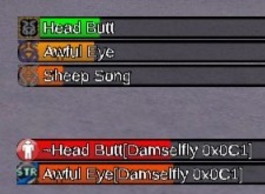

# tTimers
Shows how long your buffs and debuffs have left, plus recast timers for your spells and abilities.

This is a fork of [ThornyFFXI/tTimers](https://github.com/ThornyFFXI/tTimers) for Ashita v4. It adds stability fixes and optional Blue Magic debuff timers for LandSandBoat servers, tested on Phoenix XI.

## Install
1. Download `tTimers-v*.zip` from the [Releases page](https://github.com/kunomaclis/tTimers/releases). GitHub's **Source code** zips won't work because they're missing the `gdifonts` folder.
2. Unzip `tTimers` into your Ashita `addons` folder, replacing any existing `tTimers` folder.
3. In game, run `/addon reload tTimers` (or `/addon load tTimers`).

Your existing tTimers settings carry over. If you used tTimersBlu, unload it and delete its folder; its settings don't carry over.

Developers: clone with `git clone --recursive https://github.com/kunomaclis/tTimers.git`, or run `git submodule update --init --recursive` in an existing clone.

## Commands
| Command | What it does |
| --- | --- |
| `/tt` | Opens the settings menu. |
| `/tt reposition` | Shows every panel so you can drag it into place. |
| `/tt lock` | Saves panel positions and ends reposition mode. |
| `/tt custom "Label" 5m` | Adds a custom timer. Use `s`, `m`, or `h` (seconds if no suffix), or a clock time like `17:13:20`. |
| `/tt stop "Label"` | Removes a custom timer. |
| `/tt blumode` | Turns estimated Blue Magic timers on or off. |

Shift-click a timer to dismiss it. Ctrl-click to dismiss it and block it from coming back. Unblock it from the **Blocked** tab in `/tt`.

## Blue Magic

- **Confirmed timers** are always on. These spells tell you when they land, like Sheep Song, Awful Eye, and Frightful Roar.
- **Estimated timers** start with `~` and are off by default. These spells add their effect silently on hit, like Head Butt, Bad Breath, and Wild Oats, so the timer starts on any hit. Turn them on with `/tt blumode` or the **Blue Magic Estimates** checkbox under Debuffs in `/tt`.

Durations use LandSandBoat's base values for Treasures of Aht Urhgan spells up to level 75. A resist can make the real effect shorter. Timers clear when the effect wears off or the target dies. Estimated timers also clear when you zone.

Wild Oats, Sprout Smack, Pinecone Bomb, Queasyshroom, Feather Storm, and Battle Dance last longer with Chain Affinity and more TP, or with Azure Lore. Their timers account for this.

## Credits
- Thorny created [tTimers](https://github.com/ThornyFFXI/tTimers) and [gdifonts](https://github.com/ThornyFFXI/gdifonts).
- Blue Magic durations come from [LandSandBoat](https://github.com/LandSandBoat/server) spell scripts.
- [Kunomaclis](https://github.com/kunomaclis/tTimers) maintains and tests this fork.
- Thanks to the Ashita development community.
- Licensed under [MIT](LICENSE).

## AI-assisted development disclosure
AI-assisted tools were used in this fork for investigation, implementation support, and code review, including reading LandSandBoat scripts to derive Blue Magic durations. Kunomaclis directs the design, reviews every change, and tests it in game. Project decisions and maintenance responsibility remain with the maintainer.
